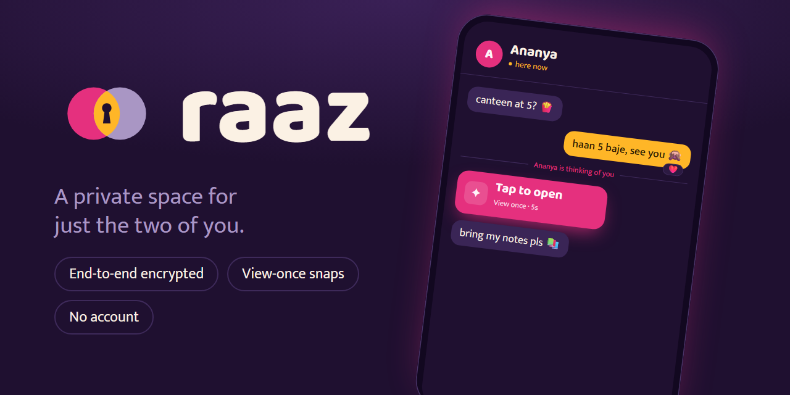
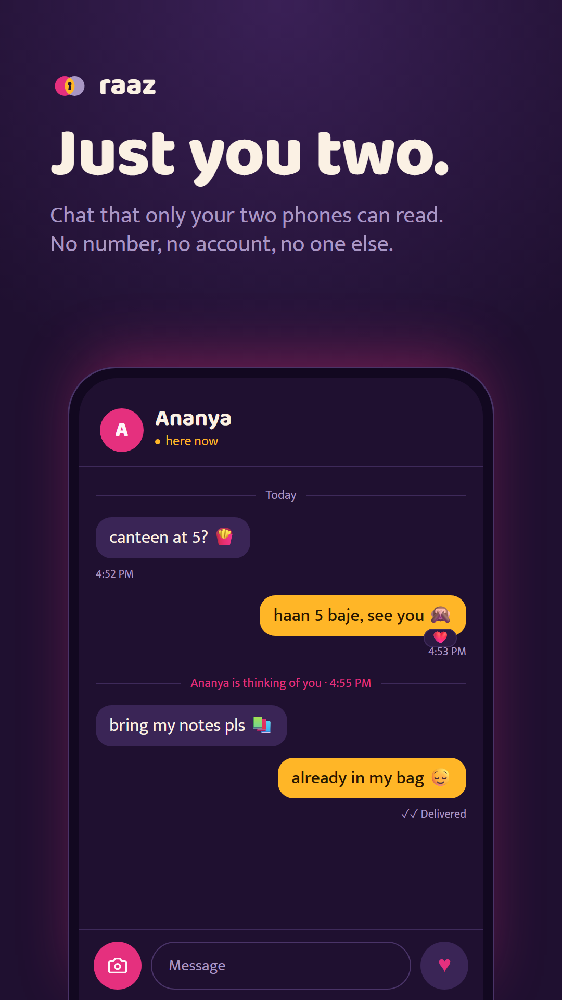
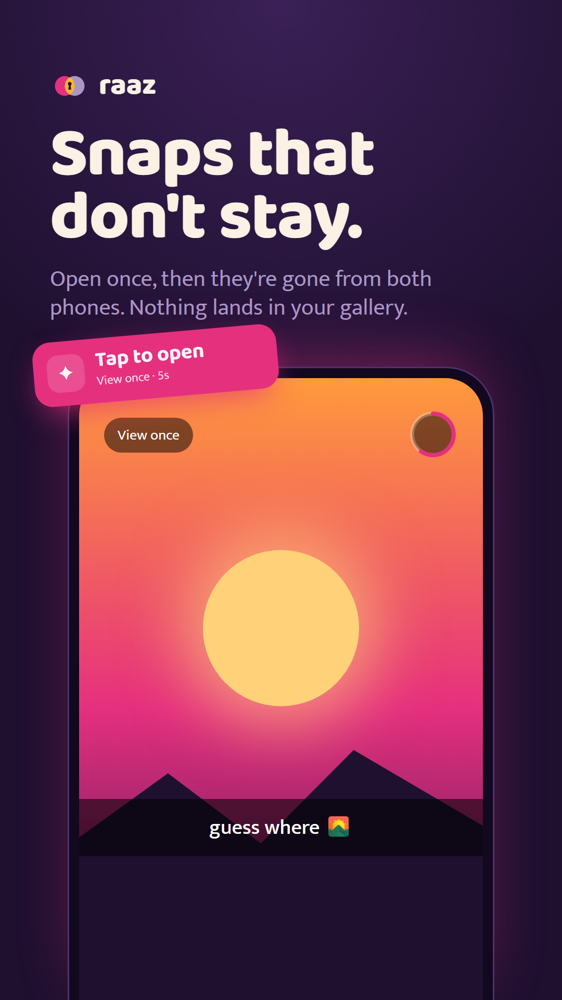
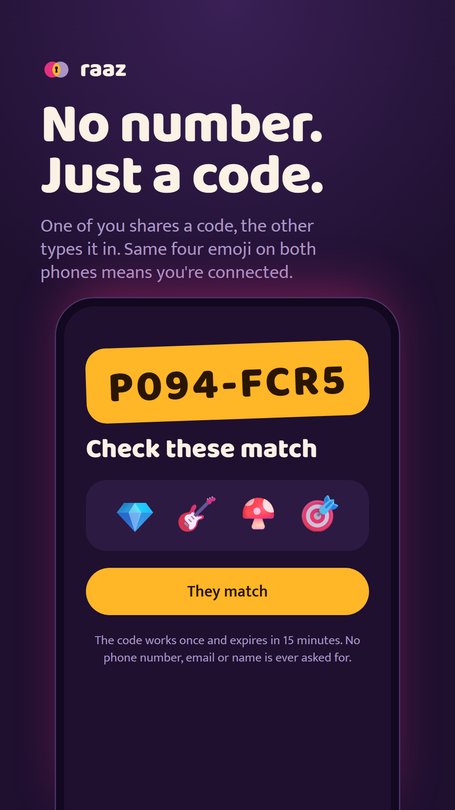

# raaz

A private space for just the two of you: chat, view-once snaps, nudges and
"where are you?", end-to-end encrypted, with no accounts. It's a PWA you
install from the browser.

<p align="center">
  
  
  
</p>

## Use it

1. Open the raaz URL on your phone (Chrome on Android, Safari on iPhone).
2. **Install it:** Chrome menu → *Add to Home screen*. On iPhone: Share → *Add to Home Screen*.
   (iPhone notifications only work once it's installed.)
3. Pick a 6-digit passcode. It locks raaz on that phone.
4. One of you taps **Make a code**; the other taps **I have a code** and types it
   (or opens the link it shares).
5. Check that both screens show **the same four emoji**, then tap **They match**.
6. Settings → **Notifications** on.

## Run it locally

```bash
npm install
npm run keys         # one-time: creates push keys in .dev.vars (never committed)
npm run dev          # app + server at http://127.0.0.1:5173
npm test             # crypto unit tests
npm run test:e2e     # two simulated phones against the running dev server
```

To try the app alone, start pairing in the browser with **Make a code**, then let a scripted
partner join:

```bash
RAAZ_URL=http://127.0.0.1:5173 PARTNER_CODE=ABCD1234 npx vitest run e2e/partner
```

## Deploy (free)

```bash
npm run ship
```

This logs in to Cloudflare (free account), builds, deploys, and uploads the push key secret.
You get `https://raaz.<your-subdomain>.workers.dev`.

Everything runs on Cloudflare's **free Workers plan**: static files are free, and each couple
is one Durable Object (SQLite). Free limits are 100,000 requests/day and 5 GB of storage, which
covers thousands of active couples. WebSocket hibernation keeps idle connections from
using up compute time.

## How it works

```
phone A ──(sealed blob)──► Worker + Durable Object "mailbox" ──► phone B
                              holds it only until B confirms, then deletes it
                              sends B an empty Web Push if B is away
```

| Piece | What it does |
| --- | --- |
| `src/core/crypto.ts` | Pairing, message sealing, the passcode vault. WebCrypto only. |
| `src/lib/engine.ts` | App state, the mailbox connection, offline outbox/inbox, disappearing messages. |
| `src/lib/pairing.ts` | Create and join flows. |
| `worker/room.ts` | The couple's mailbox (Durable Object, SQLite). |
| `worker/invite.ts` | The 15-minute meeting point used for pairing. |
| `worker/push.ts` | Empty, VAPID-signed web pushes. |
| `public/sw.js` | Offline shell and neutral or decoy notifications. |

**Pairing.** The 8-character code (40 bits) is stretched with PBKDF2 (200k rounds) into an
invite address plus a MAC key. Each phone publishes an X25519 public key with a MAC proving it
knows the code. Both derive the mailbox address, a mailbox password, the message key, and
four safety emoji with HKDF. The invite works once and expires after 15 minutes. If the emoji
match, nobody swapped keys in the middle.

**Messages.** AES-256-GCM, bound to the mailbox, padded to fixed sizes (512 B, 2 KB, 8 KB,
32 KB, 128 KB steps) so the server can't tell short from long. The server deletes each message
when the other phone acknowledges it, and drops anything undelivered after 30 days.

**On the phone.** Everything private (history, message key, partner name) is encrypted with a
random vault key, which is wrapped with your passcode (PBKDF2, 310k rounds). Locking drops
the keys from memory. Messages that arrive while locked stay sealed until you unlock.
Repeated wrong passcodes add a delay.

**Snaps.** Taken with the in-app camera (nothing goes to the gallery) or picked from the
gallery. Either way they're redrawn on a canvas, which strips EXIF/GPS, and compressed to
about 400 KB or less. View-once snaps are deleted from the receiving phone after viewing, and the sender
never keeps a copy.

## Store art

`marketing/` holds the Google Play screenshots (1080×1920) and the banner (1280×640) as HTML,
using the app's own fonts and colours. Edit the HTML, then run `node marketing/render.mjs`
(needs Chrome) to re-render `marketing/out/`.

## Limits (honest list)

- **Screenshots** can't be blocked or detected from a browser.
- **The server sees metadata:** when messages are sent, their rough size bucket, and IP
  addresses. It never sees content or who you are.
- **A 6-digit passcode** slows down someone who copies the phone's browser storage, but
  can't stop a determined attacker with that copy. The phone's own lock screen matters too.
- **Notifications go through Google (Android) or Apple (iPhone).** The push is empty; they
  only see that a push happened.
- **One partner per phone, one phone per person.** A new phone means pairing again.
  History doesn't move between phones.
- **Lose the passcode, lose the history.** That's the point of the vault.
- **iPhone:** install to the Home Screen first. iOS 16.4 or later is needed for notifications.
